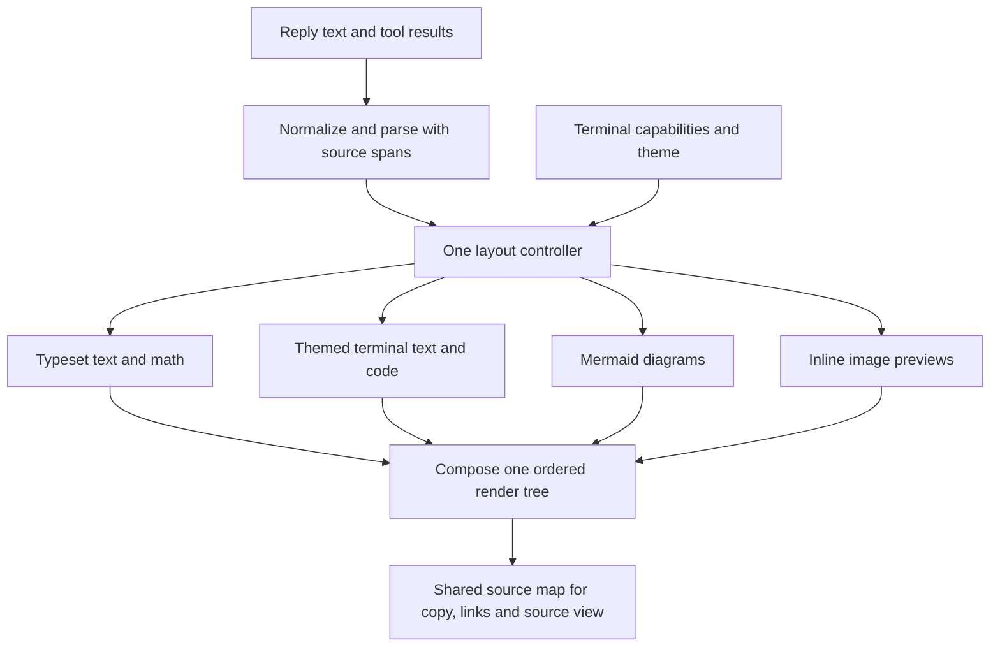

# Claude Better Render — terminal-only implementation plan

Status: implemented as Better Render 0.1.1, 2026-10-28. This document records
the original terminal-only design; see the plugin README and VERIFICATION.md
for delivered behavior and the completed checks.

## Product

One AJ-owned mod in `my-mods` that combines typeset answers, themed Markdown,
Mermaid diagrams, inline images from tools, and previews of pasted images.

- Display name: **Claude Better Render**.
- Plugin ID: `better-render`; install ID: `better-render@my-mods`.
- Proposed folder: `plugins/claude-better-render/`.
- Command: `/render`, with `/better-render` as the unambiguous alias.
- Claude Code 2.1.312 rejects the requested literal ID `claude-better-render`
  because `claude-` is reserved. This was checked with the installed validator.
- No Desktop, VS Code extension, or main Claude Chat customization in this plan.
- Follow the terminal's font and light/dark palette by default. AJ's current
  Ghostty config selects Berkeley Mono Bold and GitHub Light Colorblind.

## Features and upstream sources

| Source | Incorporate | Integration boundary |
| --- | --- | --- |
| [Intelligent UI](https://github.com/razorback16/cc-intelligent-ui) | Typst Markdown/math rendering, text measurement, page fitting, source-aware copying | Adapt rendering components; do not import its complete hook registration, installer, updater, or plan-approval behavior. |
| [Prismantis](https://github.com/NahumLitvin/prismantis) | Themes, headings, tables, syntax colors, callouts, copy actions, optional tool cards, textual charts | Use one token/theme system and adapt pure drawing helpers. No second independent reply renderer. |
| [Mermaid Inline](https://github.com/dazebug/mermaid-inline) | Graphical diagrams, font/cell sizing, Unicode fallback | One diagram service per source block; never render the same Mermaid block through Prismantis as well. |
| [Inline Images](https://github.com/kbrianps/claude-inline-images) | Images returned by Read and SendUserFile, captions and file links | Preserve the original tool result and append one preview at its visible render site. |
| [Claude Image View](https://github.com/jarrodwatts/claude-image-view) | Pasted-image thumbnails before submission | Shared image decoder/cache; a preview band appears only while images are in the draft. |

PNG support is the baseline. Include JPEG/WebP conversion in the full initial
release where a verified converter is available; otherwise retain a usable file
link. Unsupported image formats and diagram types remain readable source/links.
Animated GIF playback, arbitrary HTML apps, and video playback are outside this
initial scope. Figures is useful prior research, but is not an additional engine
to bundle into the five requested sources.

All five checked project licenses are MIT. Preserve their copyright notices and
license texts for any adapted code. Record transitive licenses separately:
Intelligent UI's vendored packages include Apache-2.0 components as well as MIT
components. Font files have their own licenses; do not redistribute the user's
Berkeley Mono files. Attribute the work without implying upstream endorsement.

### Source snapshots inspected

| Project | Version | Commit |
| --- | --- | --- |
| cc-intelligent-ui | 0.3.4 | `18f2e67b1765f2abffc05e8daa4a7039f669de38` |
| prismantis | 0.36.0 | `ed085d7c7d649241025a739d398f00c2d3b0c9a9` |
| mermaid-inline | 0.1.3 | `95fe13c4ed4eb9c6163d1abf09fd8212281c5bd0` |
| claude-inline-images | 0.2.0 | `ced2e2cfeb4214ccd8b2f42df432232bc359a8cb` |
| claude-image-view | 0.2.0 | `370b8e7bc0708bebe9762e63534f7ca18bc3e802` |

## Rendering design



The core rule is one owner per block and one owner per render site. Register one
coordinated handler for each of AssistantMessage, ToolUse, ToolResult, ToolGroup,
AbovePrompt, and the settings/gallery pane where needed. Do not chain the five
upstream registration functions and hope their replacements compose.

Parse replies into blocks with stable IDs and exact original source ranges.
Keep prose, code, tables, math, Mermaid, and image links distinguishable. Rendering
is a projection of that source; saved messages and model-visible tool results
remain intact.

### Modes

- **Auto (default):** typeset completed document blocks when the terminal and
  dependencies support it; show themed text while rendering is pending and as a
  fallback. Use one coordinated visual style across diagrams and text.
- **Text:** Prismantis-style text, tables, code and Unicode diagrams. This remains
  useful without image support or Typst.
- **Typeset:** request graphical document rendering, but still fall back visibly
  on individual failures. Never replace a readable reply with an empty box.
- **Off:** pass rendering through to the other mods/Claude.

Native terminal cells cannot use arbitrary per-message font sizes. Font and size
controls apply to the graphical typeset mode; text mode follows the terminal.
Keep code easy to copy, with source-copy buttons in both modes.

### Streaming, caching and processes

- Parse incrementally; incomplete code/diagram fences stay visible as source.
- Do not compile the full answer for every token. Batch updates, prioritize
  visible blocks and limit background rendering concurrency (initially two).
- Preserve the last valid drawing while an updated drawing is pending; never
  silently truncate content. Very large blocks paginate or fall back to text.
- Key cached renders by content, renderer/version, theme, font metrics, and
  available width. File previews also include an identity that changes when
  content changes; a path plus byte length alone is insufficient.
- Attach a session generation and request revision to each job. Ignore stale
  completions after clear, resume, mode changes, or reload.
- Use bounded memory/disk caches. Stop timers, workers and watchers on unload or
  session transition and restart only what the new session needs.
- Typst enables full typesetting. The graphical Mermaid worker may use Node;
  bundle its required libraries and pin their versions. Verify exact build and
  runtime requirements before implementation, and avoid first-render downloads.
- Pass compiler arguments as argument arrays. Constrain document compilation to
  a dedicated working directory; diagrams must not inherit arbitrary filesystem
  or network access from model-authored source.

## Image behavior

Tool previews appear once next to the corresponding result, whether Claude
groups tools or expands them. Captions, errors, non-image attachments and file
links must survive. PNG bytes should be used within host limits; large images
should be resized before transfer instead of sending an unusable remote path.

Pasted previews appear before send and disappear when sent/deleted. Prefer
supported prompt events; use a single bounded poll only where the host does not
report image-paste changes. Include session identity in draft/cache keys. Handle
partially written images with bounded retries rather than caching failure forever.

No always-visible usage strip or dashboard. `/render` opens settings on demand.
Coordinate explicitly with `/plugin-h`: expose/read a shared visibility value
instead of creating a cyclic dependency between the plugins. Hiding the plugin
band suppresses draft thumbnails, not pictures inside replies/tool results.

## Existing AJ mods

- Keep Buddy, flags, Handoff and live-thinking running.
- Keep prompt-nav's row accounting and source-view behavior.
- Default tool styling to **inherit** so compact-tools still formats the native
  row, with Better Render adding media. An explicit **cards** style can take over
  those rows through an agreed ownership setting, not competing replacements.
- Do not install independent copies of the five upstream mods as dependencies.
  There is one user-facing package, one settings model, and one updater path
  through the `my-mods` marketplace.

## Commands and settings

`/render` opens a preview/settings pane. Proposed direct commands:

```text
/render on | off
/render mode auto | text | typeset
/render theme terminal | <preset>
/render font terminal | <installed family>
/render size <percent>
/render images on | off
/render mermaid on | off
/render preview on | off
/render tools inherit | cards
/render copy
/render doctor
```

`doctor` explains the selected rendering mode, font, available dependencies and
why a feature fell back. It must not assume that every terminal advertising a
graphics protocol actually supports Claude's image placement requirements.

## Defects and risks found during research

1. **Reproduced: truncated PNG throws in Inline Images.** Its `pngSize` helper
   checks only bytes 1–3, then reads dimensions at offsets 16/20 without checking
   buffer length. Calling the actual helper with base64 for `[137,80,78,71]`
   raised `RangeError: Offset is outside the bounds of the DataView` under Node.
   Validate length, full signature, IHDR and positive bounded dimensions. An
   invalid image must not break its tool row.
2. **Static finding: stale same-size file previews.** Inline Images caches by
   `path:size`. Rewriting the same path with a different image of equal size can
   reuse the previous picture. Reproduce with a fixture, then key by content or
   a sufficiently strong file identity.
3. **Static finding: session-insensitive draft preview key.** Image View's
   `shownKey` uses image numbers only; its session-start handler resets the
   capability flag but not this key or the image caches. Verify clear/resume with
   `[Image #1]` in both sessions; reset per-session state and generation-gate jobs.
4. **Composition conflict, not an upstream defect:** three requested mods replace
   AssistantMessage and several handle tool images independently. One layout
   controller must prevent double rendering and preserve every source span.
5. **Documented host limitations:** image-selection copying differs from native
   terminal text, especially across multiple messages, SSH and multiplexers.
   Preserve reliable source-copy actions and a text mode. Do not claim to fix
   terminal/host limitations that a mod cannot control.
6. **Sizing risk:** upstream geometry uses terminal-wide columns and minimum widths
   in several paths. Test actual transcript width with Buddy docked, not just
   total terminal width; never let a minimum preview width exceed available room.

These are a starting regression list, not a claim that every upstream bug has
been found or fixed. Only the first defect was executed in isolation during this
planning pass; the others need targeted reproduction during implementation.

## Build and verification sequence

1. Build the single renderer facade, source-span parser, theme model and text
   fallback. Add the original-source copy actions and on/off control.
2. Add the shared image service and both draft/tool previews. Reproduce and fix
   header, stale-cache, session-transition and duplicate-render cases.
3. Add Mermaid graphical/Unicode outputs and Typst typesetting. Align fonts,
   sizing, source-copy behavior and asynchronous job lifetimes.
4. Complete settings, mode selection, optional tool cards, upstream notices and
   the `my-mods` marketplace entry. Validate the combined plugin and test every
   existing AJ mod integration affected by its hooks.
5. Run offline PTY fixtures in Ghostty-compatible graphical mode and text-only
   mode, then inspect real terminal screenshots and interactions: long tables,
   streaming fences, CJK/emoji, malformed math/diagrams, narrow/wide layouts,
   Buddy dock, scrolling, expanded tools, source copying, paste/send/delete,
   clear/resume/reload, and simultaneous sessions with different settings.
6. Verify graphical output in a real supported terminal; tests that only inspect
   the render tree are insufficient. Treat SSH/tmux as separately tested
   capability profiles, with readable fallback until proved working.
7. Once checks pass, publish the versioned package and install consistently
   across AJ's actual profiles. Read back the installed versions. Report which
   running sessions still need reload/restart; do not equate files on disk with
   code already loaded in a process.

Acceptance: one installed mod supplies all five requested feature groups,
preserves readable output on failures, does not duplicate media or lose text,
keeps copying dependable, and coexists with AJ's other mods. No new model calls
are required for rendering. Optional diagram-writing guidance, if added, is
explicit and does not alter the stored conversation.
